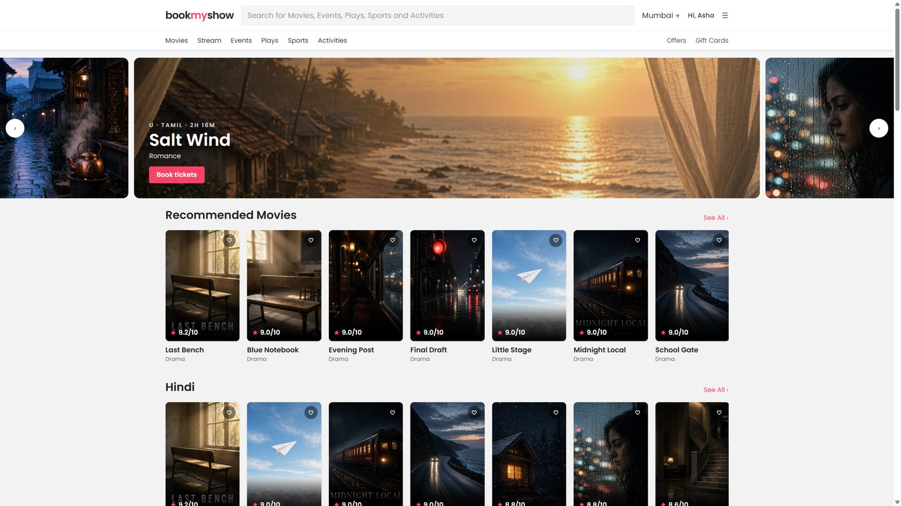
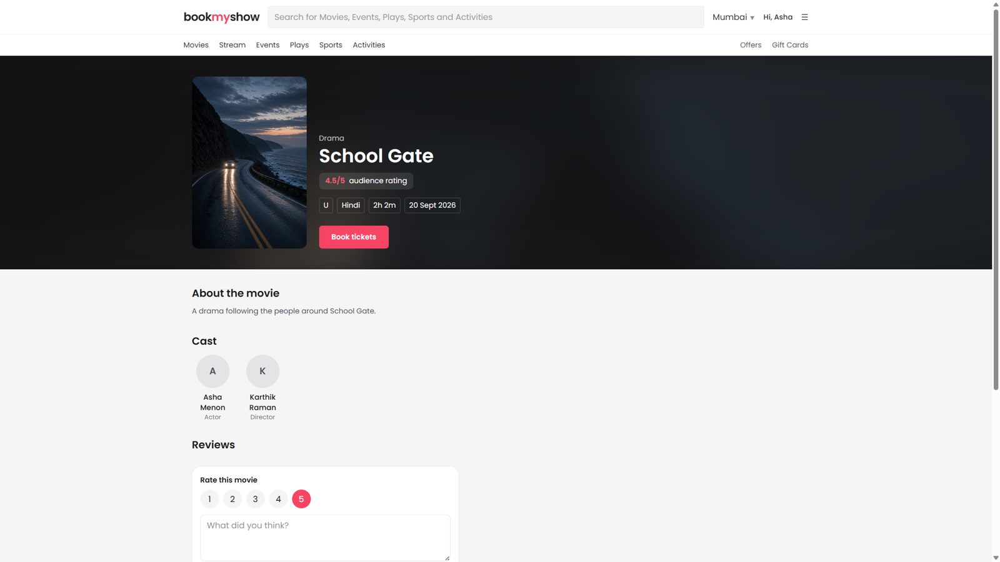
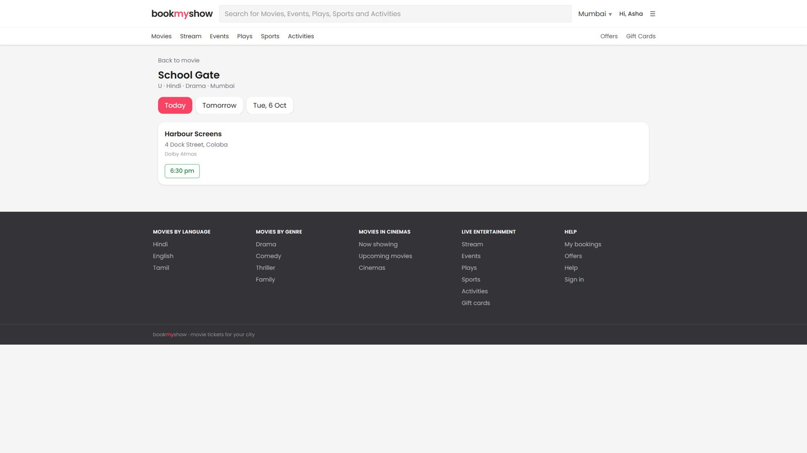
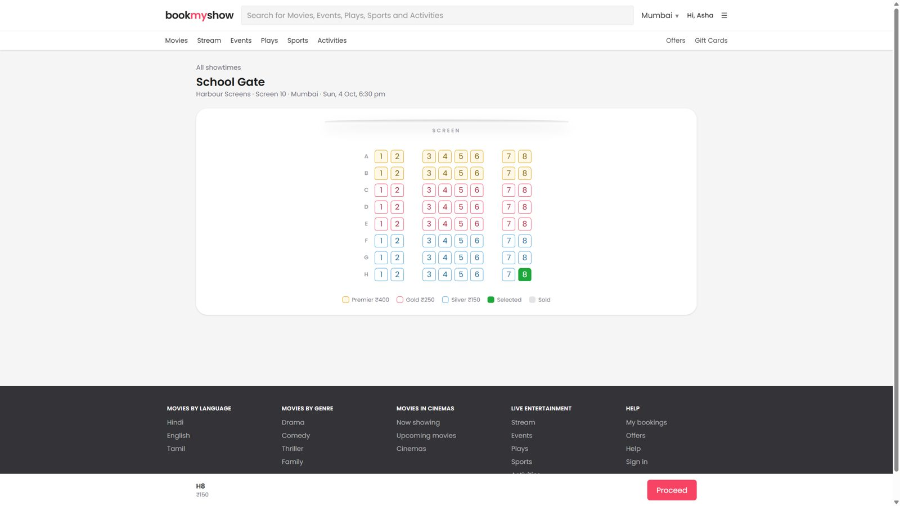
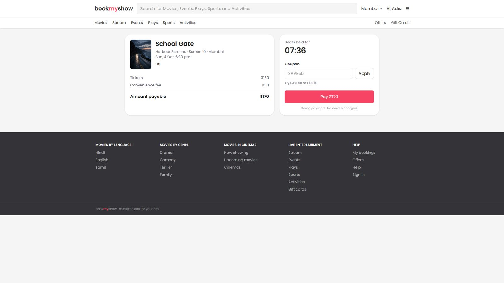
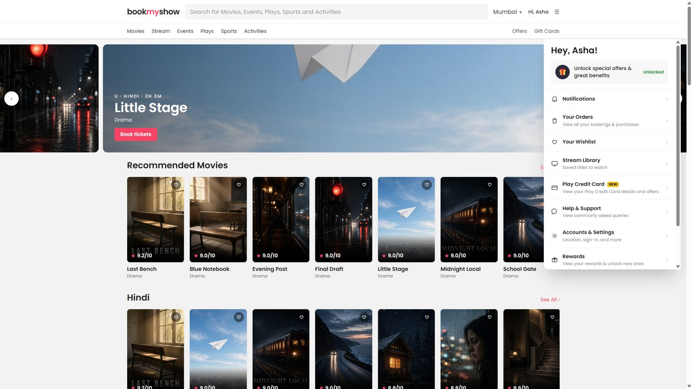
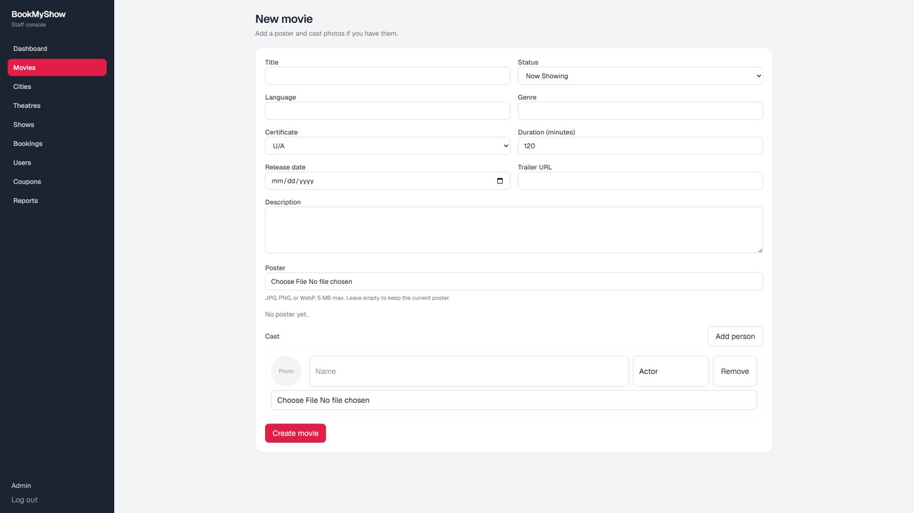

# BookMyShow

A movie ticket site with two websites and one API. Customers browse films and book seats. Staff manage the catalogue, screens, and bookings. This is a demo: payment is simulated, and there is no live card charge.

## Screenshots

**Homepage.** Light header, city, search, and poster rows. Every now-showing film can be booked.



**Movie page.** Poster, rating, cast, and Book tickets.



**Showtimes.** Dates and green time chips for the selected city.



**Seat map.** Premier, gold, and silver. The green seat is the one the customer picked.



**Checkout.** The server price, a flat convenience fee, and a coupon box. Pay is a demo and does not charge a card.



**Account menu.** Orders, wishlist, stream library, offers, rewards, and BookAChange.



**Admin.** Staff can add a movie poster and a photo for each cast member. JPG, PNG, or WebP, up to 5 MB.



## What you can show in an interview

Three programs talk to each other:

| Piece | What it is | Address |
| --- | --- | --- |
| API | Django and Django REST Framework | http://127.0.0.1:8000 |
| Customer site | Next.js | http://localhost:3000 |
| Admin site | Next.js | http://localhost:3001 |

The customer site never links to the admin site. Both call the same API.

- Customer and public routes live under `/api/v1/`.
- Staff routes live under `/api/v1/admin/` and require `is_staff`.
- Login is by email. A customer cannot sign in on the admin site. A staff user cannot sign in on the customer site.
- Each site keeps its own JWT access and refresh tokens in its own `localStorage`.

## Tech stack

**API**

- Python, Django 5, Django REST Framework
- SimpleJWT for access and refresh tokens
- SQLite while developing
- Pillow for poster and cast-photo checks
- django-filter and django-cors-headers
- Time is stored in UTC and shown in Asia/Kolkata

**Both websites**

- Next.js 16, React 19, JavaScript (not TypeScript)
- Tailwind CSS 4
- App Router

There is no Redis, Celery, or separate payment service. Seat holds expire in the database.

## How a booking works

This is the part worth walking through.

1. **Catalogue.** A movie is Coming soon, Now showing, or Ended. Only Now showing movies get showtimes. Coming soon movies stay on the dark rail and cannot be booked yet.
2. **Showtimes.** A show belongs to one movie and one screen. The screen already has a seat layout: rows A–H, premier at the front (₹400), gold in the middle (₹250), silver at the back (₹150). Shows run at 10:00 am, 2:00 pm, and 6:30 pm for today and the next two days, in Mumbai, New Delhi, and Bengaluru.
3. **No double booking of a screen.** The show’s end time is the movie length plus a 20-minute gap. The API refuses a new show that overlaps another show on the same screen. Three films can share one screen because each uses a different time slot.
4. **Pick seats.** The seat map marks a seat as available, held, booked, sold to you, blocked, or an aisle. A customer can hold at most 10 seats.
5. **Hold.** Proceed creates one pending booking and holds those seats for 8 minutes. The database locks the rows while it does this, so two people cannot hold the same seat. If that customer already had an older pending booking, that older hold is released first.
6. **Price is calculated on the server.** The browser does not send the price. The API reads `ShowTierPrice` for that show. A coupon, if it is valid, discounts the ticket subtotal only. `SAVE50` takes ₹50 off. `TAKE10` takes 10 percent off. The discount cannot be larger than the subtotal. A flat convenience fee of ₹20 is added after the discount.
7. **Pay.** Demo pay marks the booking confirmed, writes one `BookedSeat` per seat, deletes the holds, and stores a mock successful payment. The active seat is unique per show, so a second pay for the same seat fails. The ticket id is shown as `BMS` plus the booking id.
8. **Cancel.** Cancelling a confirmed booking frees the seats and marks the mock payment refunded. A pending booking that runs out of time is expired and its hold is deleted. Confirmed seats are not deleted as history; they are marked inactive, and the seat label is kept.

## What staff can do

From the admin site, or Django admin, staff can manage cities, theatres, screens, seat layouts, movies, cast, shows, coupons, users, and bookings.

Poster and cast uploads reject an empty file, a file that is not an image, and a file over 5 MB. Leaving the file input empty keeps the current image. A “remove” action deletes the file.

## What is a catalogue, not a checkout

Stream, Events, Plays, Sports, Activities, and Gift Cards are browsable lists (22 items each) for the selected city. They do not use the seat map.

Play Credit Card, Rewards, the help form, and BookAChange are in-app pages:

- Play Credit shows the offers `SAVE50` and `TAKE10`. It is not a bank card.
- Rewards count confirmed bookings. The stamps do not change the price.
- The help form stays on the page. It is not sent to a support desk.
- BookAChange explains cancel, then book again. It is not a resale market.
- Wishlist and Stream Library are saved in this browser, not on the user row in the database.
- Other offer tiles are partner offers. Only `SAVE50` and `TAKE10` apply at checkout.

## Run it locally

From `backend`, with the virtualenv Python:

```bash
python -m venv .venv
.venv\Scripts\python -m pip install -r requirements.txt
.venv\Scripts\python manage.py migrate
.venv\Scripts\python manage.py seed
.venv\Scripts\python manage.py runserver
```

`seed` loads cities, theatres, movies, shows, coupons, and sample bookings. If data is already there, it does nothing. `seed --reset` deletes that data and loads it again.

If you add movies later and they have no showtimes, run:

```bash
.venv\Scripts\python manage.py fill_showtimes
```

That command only adds screens and shows. It does not change existing bookings.

Then, in two other terminals:

```bash
cd customer-frontend
npm install
npm run dev
```

```bash
cd admin-frontend
npm install
npm run dev
```

Both sites call `http://127.0.0.1:8000` unless `NEXT_PUBLIC_API_URL` is set.

## Demo logins

| Who | Email | Password |
| --- | --- | --- |
| Staff | admin@bookmyshow.test | Admin@12345 |
| Customer | customer@bookmyshow.test | Customer@12345 |
| Customer | ravi@bookmyshow.test | Customer@12345 |

Coupons: `SAVE50` and `TAKE10`.

Django admin is at http://127.0.0.1:8000/admin/ with the staff login.
